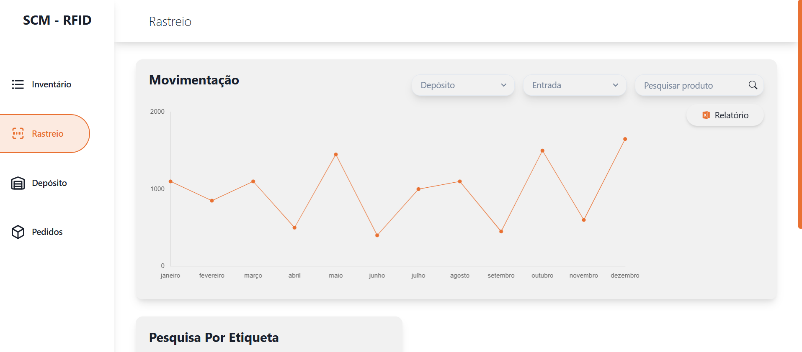
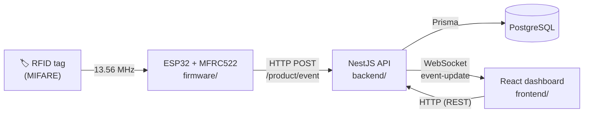

# rfid-tracking

**Supply chain visibility with RFID.** A prototype that tracks product batches across the points of a supply chain: an ESP32 reads RFID tags, a NestJS API records each movement, and a React dashboard updates in real time.

Built as my undergraduate thesis in Information Systems at **PUCRS (2024)**.

> **Thesis:** *Visibilidade da Cadeia de Suprimentos com RFID: um protótipo para gestão de inventário e rastreamento de produtos* (Supply Chain Visibility with RFID: a prototype for inventory management and product tracking). [Full text (PDF, in Portuguese)](docs/thesis.pdf)
> **Author:** José Henrique Martins Dotta · **Advisor:** Prof. Dilnei Venturini



## The problem

Manual stock counts are slow and error-prone, and they leave companies without a clear view of where their products are between receiving, storage, transportation and shipping. This project explores how RFID and IoT can give that visibility in real time: every time a tagged batch passes a reader, the system knows where it is, how full each deposit is and whether planned orders will run into a stockout.

## Architecture



1. Each **tag** represents a product instance (a physical batch). Its content is `instanceId-productId`.
2. Each **reader** is installed at a **deposit** (registration, storage, transportation or shipping).
3. On every read, the API records a **movement event** if the instance changed deposit, then notifies the dashboard over WebSocket.
4. The dashboard shows inventory per deposit, occupancy, movements over time and a **negative stock projection** that compares balances (FIFO) against planned orders.

## Repositories

This repository groups the three parts of the project as Git submodules:

| Folder | Repository | What it is | Stack |
| --- | --- | --- | --- |
| [`backend/`](https://github.com/JoseMD12/tcc-back) | tcc-back | REST API + WebSocket, business rules, data model | NestJS 10, Prisma 6, PostgreSQL, Socket.IO, ExcelJS |
| [`frontend/`](https://github.com/JoseMD12/tcc-front) | tcc-front | Web dashboard with four screens | React 18, Vite, Chakra UI, Chart.js |
| [`firmware/`](https://github.com/JoseMD12/ESP32-ReadTag) | ESP32-ReadTag | RFID reader firmware | ESP32, MFRC522, Arduino |

Each repository has its own README with details: endpoints and data model in the backend, screenshots in the frontend, wiring and configuration in the firmware.

## Running locally

Requirements: Git, Docker, Node.js 18+ and Yarn. For the reader: an ESP32, an MFRC522 module and the Arduino IDE.

```bash
# 1. Clone with the submodules
git clone --recurse-submodules https://github.com/JoseMD12/rfid-tracking.git
cd rfid-tracking

# 2. Environment: one copy for docker-compose, one for the API
cp .env.example .env
cp .env.example backend/.env

# 3. Database
docker compose up -d

# 4. API (port 3000)
cd backend
yarn install
npx prisma migrate deploy
yarn dev

# 5. Dashboard (port 5173), in another terminal
cd frontend
yarn install
yarn dev
```

6. **Reader (optional):** wire the ESP32 to the MFRC522, set the Wi-Fi, the API address and the deposit ID in the firmware, and flash it. See the [firmware README](https://github.com/JoseMD12/ESP32-ReadTag).

Already cloned without submodules? Run `git submodule update --init`.

## Limitations

This is an academic prototype, kept as it was presented:

- The MFRC522 reads within a few centimeters and was used to simulate a long-range antenna; a real scenario would call for UHF readers.
- There is no authentication, no automated tests and part of the configuration is hardcoded.
- The read-processing service has a known concurrency issue, documented in the [backend README](https://github.com/JoseMD12/tcc-back#limitations-and-what-i-would-do-differently) along with what I would do differently today.
